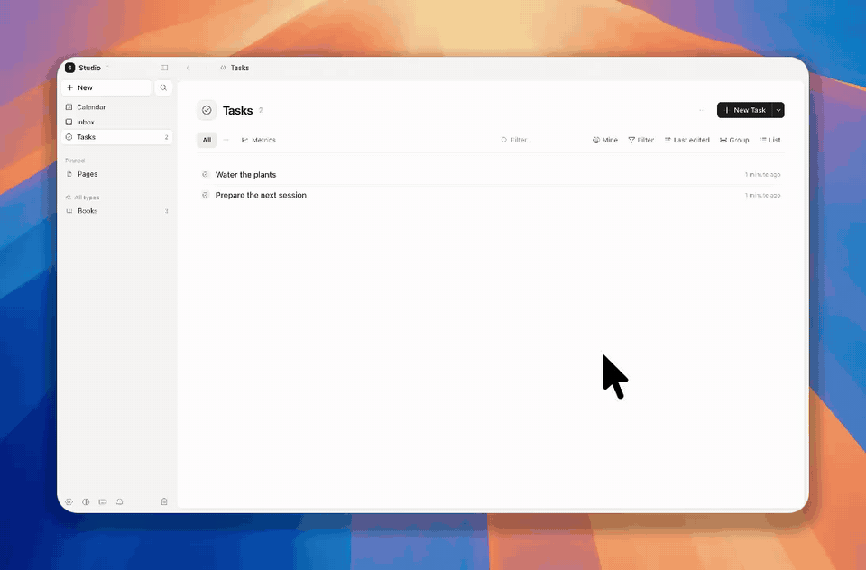

<h1 align="center">
   Vasta
</h1>

<p align="center">
  <strong>Tus notas, tareas y días en una sola app, en tu computadora o en tu propio servidor.</strong><br/>
  Local-first. Funciona sin conexión. No necesitas un servidor para empezar; pásate a uno cuando quieras.
</p>

<p align="center">
  <a href="README.md">English</a> · <a href="README.pt-BR.md">Português</a> · <b>Español</b> · <a href="README.zh-CN.md">简体中文</a> · <a href="README.ja.md">日本語</a>
</p>

<p align="center">
  <a href="https://github.com/ariedotme/vasta/releases/latest"></a>
  <a href="https://github.com/ariedotme/vasta/blob/main/scripts/downloads-badge.mjs"></a>
  <a href="https://github.com/ariedotme/vasta/actions/workflows/ci.yml"></a>
  <a href="LICENSE"></a>
  
</p>

<p align="center">
  <a href="#primeros-pasos">Primeros pasos</a> ·
  <a href="#por-qué-vasta">Por qué Vasta</a> ·
  <a href="#en-tu-servidor">En tu servidor</a> ·
  <a href="#app-de-escritorio">App de escritorio</a> ·
  <a href="#documentación">Documentación</a> ·
  <a href="CONTRIBUTING.md">Contribuir</a>
</p>

<p align="center">
  <picture>
    <source media="(prefers-color-scheme: dark)" srcset="docs/assets/today-dark.jpg" />
    
  </picture>
</p>

> Esta es una traducción del [README en inglés](README.md) (actualizada el 2026-10-24). La app y la
> documentación de `docs/` todavía están solo en inglés, salvo la [guía para tu servidor](docs/deploy.es.md)
> ([#34](https://github.com/ariedotme/vasta/issues/34)).

Vasta es una alternativa de código abierto y autoalojada a Capacities y Notion. Guarda todo como objetos con tipo: páginas, tareas, libros, personas o un tipo que tú
creas. Cada día tiene una nota. Las capturas desde tu teléfono, tu navegador o un agente van ahí.
Cada dispositivo guarda una copia de tus espacios, así que la app funciona sin conexión. Tu
servidor mantiene todos los dispositivos sincronizados.

> [!NOTE]
> Vasta está en alfa. Su autora la usa todos los días, pero algunas partes son nuevas. Haz copias
> de seguridad ([docs/deploy.es.md](docs/deploy.es.md#actualizaciones-y-copias-de-seguridad)).

Si Vasta te resulta útil, dale una ⭐ en GitHub. Lo hace una sola persona, y las estrellas son la
forma en que otras personas lo encuentran.

## Primeros pasos

<table>
<tr>
<th width="50%">En tu computadora</th>
<th width="50%">En tu propio servidor</th>
</tr>
<tr>
<td valign="top">

**Sin servidor, sin Docker, nada que configurar.**

1. [Descarga la app de escritorio](https://github.com/ariedotme/vasta/releases/latest)
   para macOS, Windows o Linux.
2. Elige **Start on this computer**.

La app ejecuta Vasta por ti. Tus notas se quedan en esa computadora.

</td>
<td valign="top">

**Todos tus dispositivos, el teléfono incluido, y espacios compartidos.**

1. Ejecuta el servidor con Docker ([En tu servidor](#en-tu-servidor)).
2. Ábrelo en un navegador, en tu teléfono o en la app de escritorio.

Las capturas desde Telegram, la extensión del navegador y los agentes llegan desde cualquier lugar.

</td>
</tr>
</table>

> [!TIP]
> **Empieza en tu computadora y muévete después.** Cuando quieras sumar tu teléfono u otras
> personas, abre Settings › Server › **Move to a server…** en la app de escritorio. Pega el código
> de configuración del servidor o un enlace de invitación, y Vasta lleva tus notas, su historial y
> tus archivos a una cuenta nueva allí. [Cómo funciona →](docs/desktop.md#moving-to-a-server)

## Funciones

<table>
<tr>
<td width="40%" valign="middle">

### Captura en una línea

Escribe una línea en ⌘K, en Telegram o con el atajo de escritorio. Vasta lee de ella el tipo y las
propiedades: `/Task Ask Lena due:fri assignee:lena`.

[Captura →](docs/capture.md)

</td>
<td width="60%">

</td>
</tr>
<tr>
<td width="40%" valign="middle">

### Tus propios tipos

Crea un tipo para cualquier cosa. Dale propiedades: texto, números, fechas, selecciones,
relaciones, fórmulas. Muéstralo como lista, tabla, tablero, cuadrícula, muro o galería.

[Modelo de datos →](docs/data-model.md)

</td>
<td width="60%">
<picture>
  <source media="(prefers-color-scheme: dark)" srcset="docs/assets/types-dark.jpg" />
  
</picture>
</td>
</tr>
<tr>
<td width="40%" valign="middle">

### Trabajo en equipo

Comparte un espacio con otras personas. Usa tableros, sprints, comentarios, @menciones y
notificaciones. Las métricas de flujo muestran qué tan rápido avanza el trabajo.

[Cuentas y espacios →](docs/accounts.md)

</td>
<td width="60%">
<picture>
  <source media="(prefers-color-scheme: dark)" srcset="docs/assets/board-dark.jpg" />
  
</picture>
</td>
</tr>
<tr>
<td width="40%" valign="middle">

### Un solo calendario

Notas diarias, tareas, objetos con fecha, sprints y eventos van a un solo calendario. Agrega tus
otros calendarios con sus enlaces iCal.

</td>
<td width="60%">
<picture>
  <source media="(prefers-color-scheme: dark)" srcset="docs/assets/calendar-dark.jpg" />
  
</picture>
</td>
</tr>
<tr>
<td width="40%" valign="middle">

### Tus agentes, tus notas

Claude Code, Codex y tus scripts leen y escriben tus notas mediante un endpoint MCP y el comando
`vasta`: buscar, consultar, crear objetos, capturar, registrar hábitos. Actúan como tú, con un
token que puedes revocar. Vasta no tiene IA dentro ni guarda claves de modelos.

[Agentes →](docs/agents.md)

</td>
<td width="60%">

```sh
claude mcp add --transport http vasta \
  https://vasta.example.org/mcp \
  --header "Authorization: Bearer <token>"
```

> Lee mis notas de las reuniones de esta semana y crea una tarea por cada
> cosa que prometí, con fecha límite el viernes.

</td>
</tr>
</table>

**También en Vasta:**

- **Primero sin conexión**: cada dispositivo guarda una copia en SQLite. Las ediciones hechas sin
  conexión en dos dispositivos se combinan.
- **Editor de bloques**: comandos con barra, menciones con `@`, embebidos, callouts, desplegables,
  columnas, tablas y backlinks.
- **Plantillas y fragmentos**: empieza los objetos de un tipo o la nota de cada día desde una
  plantilla, con marcadores (`{{date:+7d}}`, `{{ask:With whom?}}`) y bloques que solo aparecen
  cuando se cumple una condición; inserta fragmentos con `/`. [Plantillas →](docs/data-model.md#templates-and-snippets)
- **Enlaces guardados** con vista previa, una copia legible de la página y embebidos.
- **Hábitos y recordatorios** por ntfy, Telegram y la app de escritorio. [Recordatorios →](docs/reminders.md)
- **Un diario de comidas** con metas de nutrición, si lo activas.
- **Apps**: instala la web app en un teléfono (PWA). La app de escritorio agrega un atajo global de
  captura.
- **Archivos** en disco o en un bucket compatible con S3.
- **Importación** desde Capacities.

## Por qué Vasta

- **Capacities** tiene la misma idea, objetos con tipo y una nota para cada día, pero es de código
  cerrado y tus notas viven en sus servidores. Vasta funciona en tu computadora o en tu servidor,
  funciona sin conexión y tiene un importador para espacios de Capacities.
- **Notion** está en la nube y requiere una cuenta en Notion. Vasta guarda una copia completa en
  cada dispositivo y sincroniza a través de un servidor que es tuyo.
- **Obsidian** guarda archivos Markdown en tu disco; sincronizarlos es un servicio de pago o corre
  por tu cuenta, y compartir una bóveda con otras personas es difícil. Vasta trae tipos y vistas,
  sincroniza con tu propio servidor y comparte espacios con otras personas. No guarda archivos
  Markdown (hay una exportación [planeada](https://github.com/ariedotme/vasta/issues/1)).
- **AFFiNE y AppFlowy** también son de código abierto y hacen mucho más (pizarras, IA, una nube).
  Sus servidores autoalojados funcionan con Postgres y Redis, junto a sus propios servicios. El
  servidor de Vasta es un contenedor y un archivo SQLite, y se centra en notas diarias, objetos con
  tipo y captura rápida: Telegram, un atajo de escritorio, una extensión de navegador y agentes.

Vasta todavía no es para ti si necesitas una app nativa para el teléfono (es una web app que
instalas), archivos Markdown planos o que varias personas escriban en la misma nota a la vez
([#22](https://github.com/ariedotme/vasta/issues/22)).

## En tu servidor

Necesitas Docker. Haz estos pasos en el servidor:

```sh
mkdir vasta && cd vasta
curl -o compose.yml https://raw.githubusercontent.com/ariedotme/vasta/main/compose.example.yml
curl -o .env https://raw.githubusercontent.com/ariedotme/vasta/main/.env.example
docker compose up -d
docker compose logs vasta
```

1. Busca el código de configuración en el log.
2. Abre `http://127.0.0.1:5174`.
3. Crea la primera cuenta con el código de configuración.
4. Para sumar a otras personas, crea un enlace de invitación en Settings › Server accounts.

¿Empezaste con la app de escritorio en tu computadora? Sáltate el paso 3: en la app, abre
Settings › Server › **Move to a server…** y pega ahí el código de configuración. Tus notas llegan
con la cuenta nueva.

Para HTTPS, copias de seguridad, actualizaciones y buckets de archivos, lee
[docs/deploy.es.md](docs/deploy.es.md).

## App de escritorio

Descarga la app para macOS, Windows o Linux desde las
[versiones](https://github.com/ariedotme/vasta/releases/latest). Al abrirla por primera vez, elige
dónde viven tus notas:

- **Start on this computer**: no necesitas servidor. La app ejecuta Vasta por sí misma y tus notas
  se quedan en esa computadora ([docs/desktop.md](docs/desktop.md#on-this-computer)). Settings ›
  Server › **Move to a server…** las lleva a un servidor más tarde.
- **Tu servidor Vasta**: escribe su dirección.

Apple y Microsoft no firmaron la app. Por eso tu sistema la detiene la primera vez:

- **macOS**: abre Ajustes del Sistema › Privacidad y seguridad. Haz clic en **Abrir igualmente**.
- **Windows**: en el mensaje de SmartScreen, haz clic en Más información › **Ejecutar de todas
  formas**.

Para más detalles, lee [docs/desktop.md](docs/desktop.md#installing).

## Desarrollo

Necesitas Node.js 24 o posterior y pnpm 10.

```sh
pnpm install
pnpm dev          # API en 127.0.0.1:5174, web app en http://127.0.0.1:5173
pnpm test
pnpm typecheck
```

El primer arranque escribe un código de configuración en la terminal. Úsalo para crear tu cuenta.
Para empezar con datos de ejemplo, lee [CONTRIBUTING.md](CONTRIBUTING.md).

```
packages/
  core/                  modelo de datos, esquema SQLite, sync, almacén de archivos
  editor-schema/         esquema de texto enriquecido del editor y del servidor
  server/                API HTTP (Hono), canales de captura, endpoint MCP, CLI de administración
  web/                   la app: Vue 3, Tailwind, TipTap, réplica en sqlite-wasm
  desktop/               la app de escritorio (Tauri 2)
  cli/                   vasta, la CLI para agentes y scripts
  importer-capacities/   importación desde Capacities
extensions/browser/      extensión de navegador "Save to Vasta"
```

## Documentación

La documentación está en inglés.

- [Modelo de datos](docs/data-model.md): objetos, tipos, propiedades, documentos y consultas
- [Cuentas](docs/accounts.md): usuarios, espacios compartidos, tokens y cómo se protege la API
- [En tu servidor](docs/deploy.es.md): Docker, HTTPS, copias de seguridad y actualizaciones
- [App de escritorio](docs/desktop.md): instalación, cómo funciona, versiones
- [Captura](docs/capture.md): Telegram, API HTTP, extensión del navegador, Atajos
- [Agentes](docs/agents.md): el endpoint MCP y la CLI
- [Recordatorios](docs/reminders.md): ntfy, Telegram y la app de escritorio
- [Sync](docs/sync.md): cómo funciona la sincronización local-first

El servidor también describe su API de captura en `/api/openapi.json` (OpenAPI 3.1).

## Lo que viene

- Importar carpetas de Markdown, Obsidian y Notion, y una exportación a Markdown documentada
- Una API HTTP pública para leer y editar objetos
- Varias personas editando la misma nota al mismo tiempo
- Correo electrónico como canal de captura
- Calendarios CalDAV, Google e iCloud (hoy: enlaces iCal)

La lista completa está en el [roadmap](https://github.com/users/ariedotme/projects/1), como issues.
Los que tienen la etiqueta `good first issue` son un buen lugar para empezar.

## Licencia

[AGPL-3.0](LICENSE). Puedes usar, cambiar y compartir Vasta. Si ejecutas una versión modificada para
otras personas en una red, dales su código fuente.
