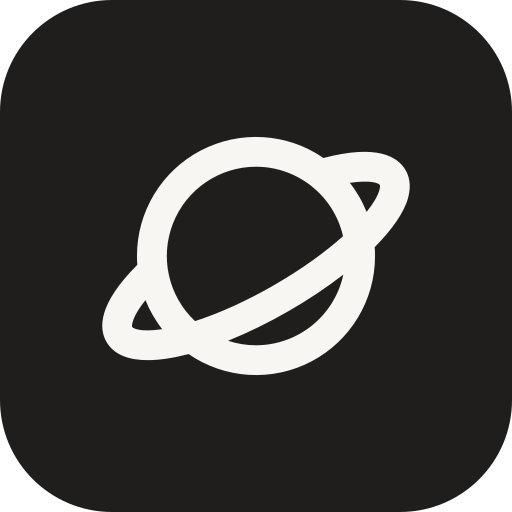
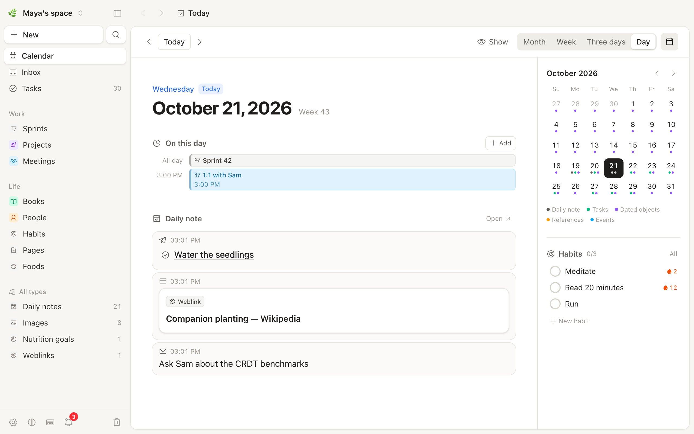
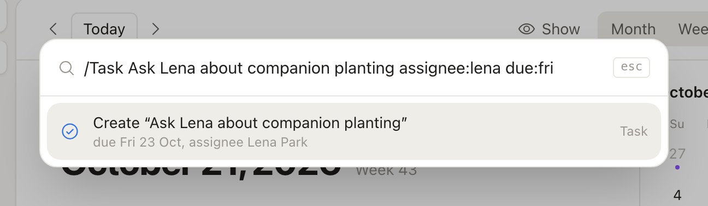
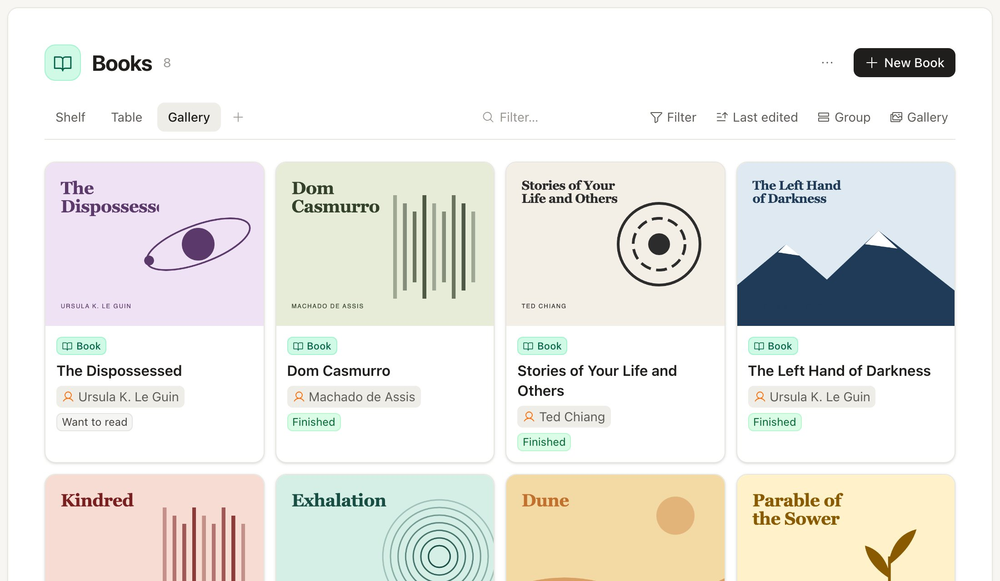
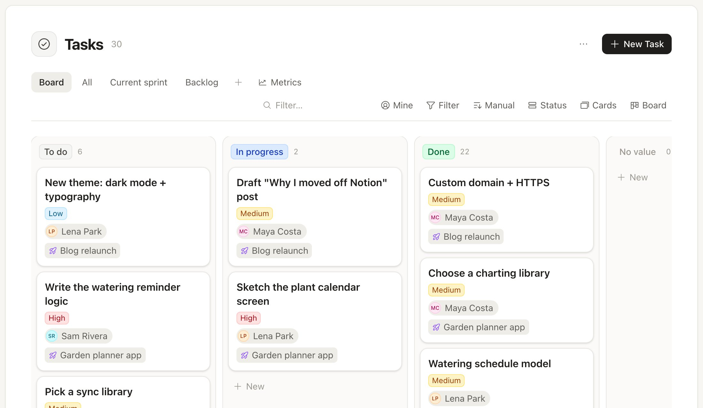
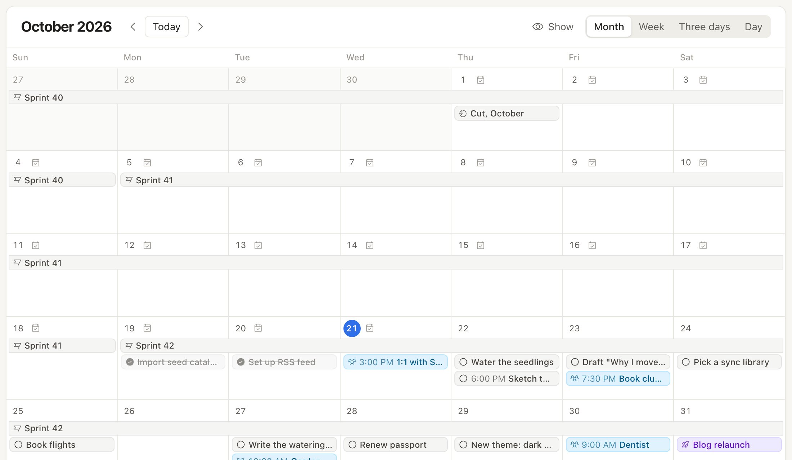

<h1 align="center">
   Vasta
</h1>

<p align="center">
  <strong>Your notes, tasks and days in one app, on your computer or your own server.</strong><br/>
  Local-first. Works offline. No server needed to start; move to one whenever you want.
</p>

<p align="center">
  <a href="https://github.com/ariedotme/vasta/releases/latest"></a>
  <a href="https://github.com/ariedotme/vasta/actions/workflows/ci.yml"></a>
  <a href="LICENSE"></a>
  
</p>

<p align="center">
  <a href="#get-started">Get started</a> ·
  <a href="#self-hosting">Self-hosting</a> ·
  <a href="#desktop-app">Desktop app</a> ·
  <a href="#documentation">Documentation</a> ·
  <a href="CONTRIBUTING.md">Contributing</a>
</p>

<p align="center">
  <picture>
    <source media="(prefers-color-scheme: dark)" srcset="docs/assets/today-dark.jpg" />
    
  </picture>
</p>

Vasta keeps everything as typed objects: pages, tasks, books, people, or a type that you make.
Each day has a note. Captures from your phone, your browser or an agent go into it.
Each device keeps a copy of your spaces, so the app works offline. Your server keeps all
devices in sync.

> [!NOTE]
> Vasta is in alpha. Its author uses it every day, but some parts are new. Make backups
> ([docs/deploy.md](docs/deploy.md#upgrading-and-backups)).

## Get started

<table>
<tr>
<th width="50%">On your computer</th>
<th width="50%">On your own server</th>
</tr>
<tr>
<td valign="top">

**No server, no Docker, nothing to set up.**

1. [Download the desktop app](https://github.com/ariedotme/vasta/releases/latest)
   for macOS, Windows or Linux.
2. Choose **Start on this computer**.

The app runs Vasta for you. Your notes stay on that computer.

</td>
<td valign="top">

**Every device, your phone included, and shared spaces.**

1. Run the server with Docker ([Self-hosting](#self-hosting)).
2. Open it in a browser, on your phone or in the desktop app.

Captures from Telegram, the browser extension and agents reach it from anywhere.

</td>
</tr>
</table>

> [!TIP]
> **Start on your computer, move later.** When you want your phone or other people in, open
> Settings › Server › **Move to a server…** in the desktop app. Paste the server's setup code
> or an invite link, and Vasta moves your notes, their history and your files into a new account
> there. [How it works →](docs/desktop.md#moving-to-a-server)

## Features

<table>
<tr>
<td width="40%" valign="middle">

### Capture in one line

Type a line in ⌘K, Telegram or the desktop shortcut. Vasta reads the type and the properties
from it: `/Task Ask Lena due:fri assignee:lena`.

[Capture →](docs/capture.md)

</td>
<td width="60%">
<picture>
  <source media="(prefers-color-scheme: dark)" srcset="docs/assets/capture-dark.jpg" />
  
</picture>
</td>
</tr>
<tr>
<td width="40%" valign="middle">

### Your own types

Make a type for anything. Give it properties: text, numbers, dates, selects, relations,
formulas. Show it as a list, table, board, grid, wall or gallery.

[Data model →](docs/data-model.md)

</td>
<td width="60%">
<picture>
  <source media="(prefers-color-scheme: dark)" srcset="docs/assets/types-dark.jpg" />
  
</picture>
</td>
</tr>
<tr>
<td width="40%" valign="middle">

### Work together

Share a space with other people. Use boards, sprints, comments, @mentions and
notifications. Flow metrics show how fast work moves.

[Accounts and spaces →](docs/accounts.md)

</td>
<td width="60%">
<picture>
  <source media="(prefers-color-scheme: dark)" srcset="docs/assets/board-dark.jpg" />
  
</picture>
</td>
</tr>
<tr>
<td width="40%" valign="middle">

### One calendar

Daily notes, tasks, dated objects, sprints and events go on one calendar. Add your other
calendars with their iCal links.

</td>
<td width="60%">
<picture>
  <source media="(prefers-color-scheme: dark)" srcset="docs/assets/calendar-dark.jpg" />
  
</picture>
</td>
</tr>
</table>

**Also in Vasta:**

- **Offline first**: each device keeps a copy in SQLite. Edits made offline on two devices merge.
- **Agents**: an MCP endpoint and a CLI let Claude Code, Codex and scripts read and write your
  notes with a token. Vasta keeps no AI keys. [Agents →](docs/agents.md)
- **Block editor**: slash commands, `@` mentions, embeds, callouts, toggles, columns, tables and
  backlinks.
- **Templates and snippets**: start a type's objects or each day's note from a template, with
  placeholders (`{{date:+7d}}`, `{{ask:With whom?}}`) and blocks shown only when a condition
  holds; insert snippets with `/`. [Templates →](docs/data-model.md#templates-and-snippets)
- **Saved links** keep a preview, a readable copy of the page and embeds.
- **Habits and reminders** through ntfy, Telegram and the desktop app. [Reminders →](docs/reminders.md)
- **A food diary** with nutrition goals, if you turn it on.
- **Apps**: install the web app on a phone (PWA). The desktop app adds a global capture shortcut.
- **Media** on disk or in an S3-compatible bucket.
- **Import** from Capacities.

## Self-hosting

You need Docker. Do these steps on the server:

```sh
mkdir vasta && cd vasta
curl -o compose.yml https://raw.githubusercontent.com/ariedotme/vasta/main/compose.example.yml
curl -o .env https://raw.githubusercontent.com/ariedotme/vasta/main/.env.example
docker compose up -d
docker compose logs vasta
```

1. Find the setup code in the log.
2. Open `http://127.0.0.1:5174`.
3. Make the first account with the setup code.
4. To add other people, make an invite link in Settings › Server accounts.

Started with the desktop app on your computer? Skip step 3: in the app, open Settings › Server ›
**Move to a server…** and paste the setup code there. Your notes come with the new account.

For HTTPS, backups, upgrades and media buckets, read [docs/deploy.md](docs/deploy.md).

## Desktop app

Download the app for macOS, Windows or Linux from the
[releases](https://github.com/ariedotme/vasta/releases/latest). On first start, choose where your
notes live:

- **Start on this computer**: no server needed. The app runs Vasta itself, and your notes stay on
  that computer ([docs/desktop.md](docs/desktop.md#on-this-computer)). Settings › Server ›
  **Move to a server…** moves them to a server later.
- **Your Vasta server**: type its address.

Apple and Microsoft did not sign the app. Thus your system stops it the first time:

- **macOS**: open System Settings › Privacy & Security. Click **Open Anyway**.
- **Windows**: in the SmartScreen message, click More info › **Run anyway**.

For more, read [docs/desktop.md](docs/desktop.md#installing).

## Development

You need Node.js 24 or later and pnpm 10.

```sh
pnpm install
pnpm dev          # API on 127.0.0.1:5174, web app on http://127.0.0.1:5173
pnpm test
pnpm typecheck
```

The first start writes a setup code to the terminal. Use it to make your account. To start with
sample data, read [CONTRIBUTING.md](CONTRIBUTING.md).

```
packages/
  core/                  data model, SQLite schema, sync, media store
  editor-schema/         rich-text schema for the editor and the server
  server/                HTTP API (Hono), capture channels, MCP endpoint, admin CLI
  web/                   the app: Vue 3, Tailwind, TipTap, sqlite-wasm replica
  desktop/               the desktop app (Tauri 2)
  cli/                   vasta, the CLI for agents and scripts
  importer-capacities/   import from Capacities
extensions/browser/      "Save to Vasta" browser extension
```

## Documentation

- [Data model](docs/data-model.md): objects, types, properties, documents and queries
- [Accounts](docs/accounts.md): users, shared spaces, tokens, and how the API is safe
- [Self-hosting](docs/deploy.md): Docker, HTTPS, backups and upgrades
- [Desktop app](docs/desktop.md): install, how it works, releases
- [Capture](docs/capture.md): Telegram, HTTP API, browser extension, Shortcuts
- [Agents](docs/agents.md): the MCP endpoint and the CLI
- [Reminders](docs/reminders.md): ntfy, Telegram and the desktop app
- [Sync](docs/sync-plan.md): how local-first sync works

The server also describes its capture API at `/api/openapi.json` (OpenAPI 3.1).

## Next

- Import from Markdown folders, Obsidian and Notion, and a documented Markdown export
- A public HTTP API to read and edit objects
- Live editing of one note by many people at the same time
- Email as a capture channel
- CalDAV, Google and iCloud calendars (now: iCal links)

The full list is on the [roadmap](https://github.com/users/ariedotme/projects/1), as issues. Items with the `good first issue` label are a
good place to start.

## License

[AGPL-3.0](LICENSE). You can use, change and share Vasta. If you run a changed version for other
people on a network, give them its source code.
