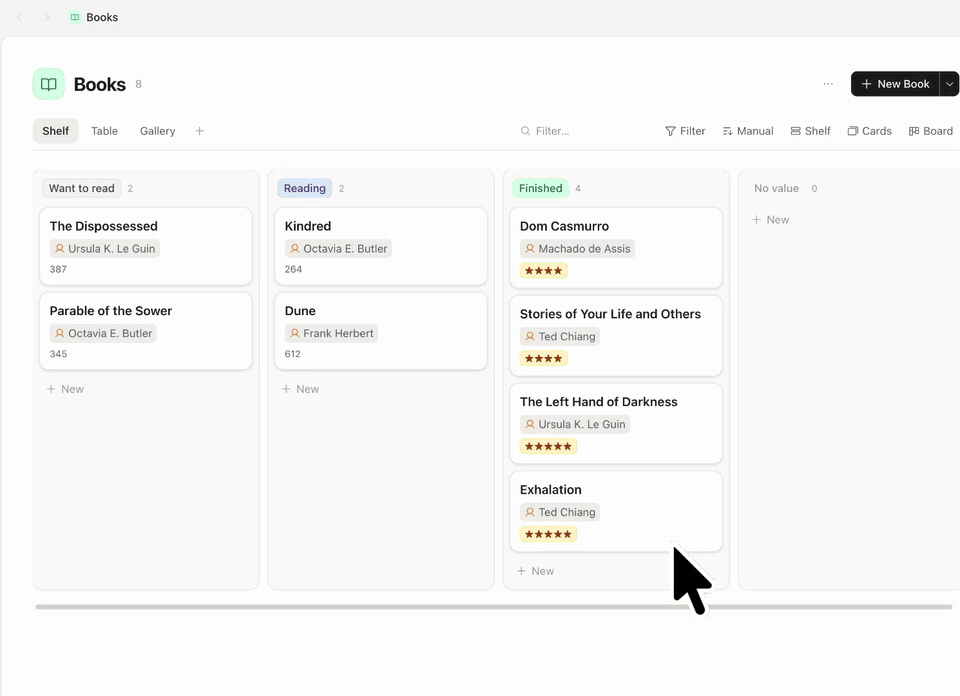
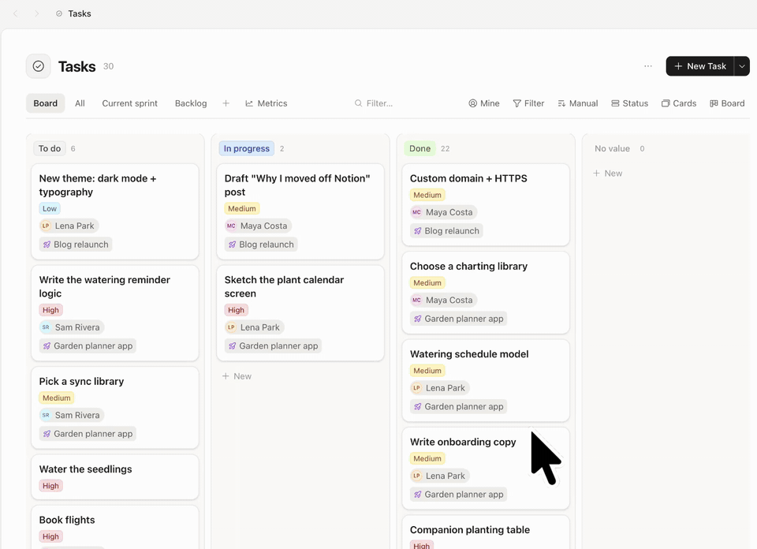
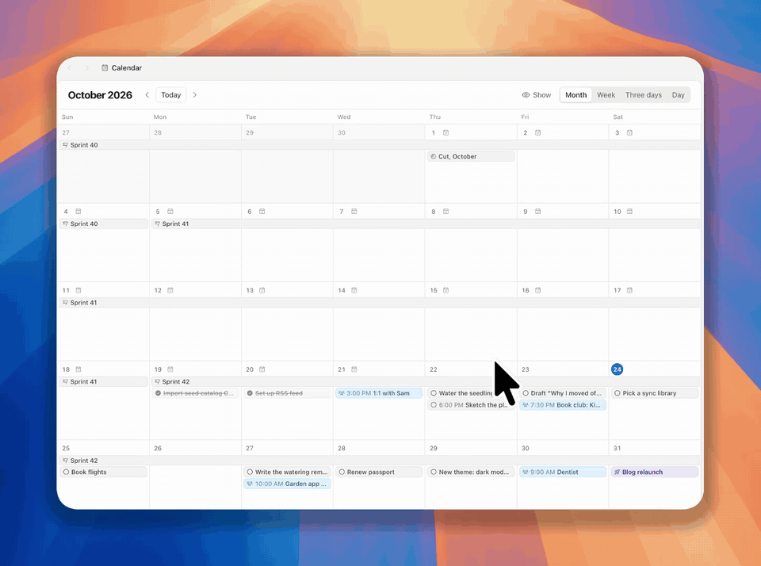

<h1 align="center">
   Vasta
</h1>

<p align="center">
  <strong>笔记、任务和每一天，都在一个应用里，运行在你的电脑或你自己的服务器上。</strong><br/>
  本地优先。离线可用。无需服务器即可开始，随时可以迁移到服务器。
</p>

<p align="center">
  <a href="README.md">English</a> · <a href="README.pt-BR.md">Português</a> · <a href="README.es.md">Español</a> · <b>简体中文</b> · <a href="README.ja.md">日本語</a>
</p>

<p align="center">
  <a href="https://github.com/ariedotme/vasta/releases/latest"></a>
  <a href="https://github.com/ariedotme/vasta/blob/main/scripts/downloads-badge.mjs"></a>
  <a href="https://github.com/ariedotme/vasta/actions/workflows/ci.yml"></a>
  <a href="LICENSE"></a>
  
</p>

<p align="center">
  <a href="#快速开始">快速开始</a> ·
  <a href="#为什么选择-vasta">为什么选择 Vasta</a> ·
  <a href="#自托管">自托管</a> ·
  <a href="#桌面应用">桌面应用</a> ·
  <a href="#文档">文档</a> ·
  <a href="CONTRIBUTING.md">参与贡献</a>
</p>

<p align="center">
  <picture>
    <source media="(prefers-color-scheme: dark)" srcset="docs/assets/today-dark.jpg" />
    
  </picture>
</p>

> 本文是[英文 README](README.md) 的翻译（更新于 2026-10-24）。应用界面和 `docs/` 中的文档目前只有英文，[自托管指南](docs/deploy.zh-CN.md)除外（[#34](https://github.com/ariedotme/vasta/issues/34)）。

Vasta 是 Capacities 和 Notion 的开源、可自托管替代品。它把一切都保存为带类型的对象：页面、任务、书籍、人物，或者你自己创建的类型。每一天都有一篇笔记，来自手机、浏览器或智能体的捕获内容都会进入这篇笔记。每台设备都保存一份你的空间副本，所以应用可以离线使用；你的服务器负责让所有设备保持同步。

> [!NOTE]
> Vasta 目前处于 alpha 阶段。作者每天都在使用它，但有些部分还很新。请做好备份（[docs/deploy.zh-CN.md](docs/deploy.zh-CN.md#升级和备份)）。

如果 Vasta 对你有用，请在 GitHub 上给它一个 ⭐。它由一个人开发，星标是其他人发现它的方式。

## 快速开始

<table>
<tr>
<th width="50%">在你的电脑上</th>
<th width="50%">在你自己的服务器上</th>
</tr>
<tr>
<td valign="top">

**不需要服务器，不需要 Docker，无需任何配置。**

1. [下载桌面应用](https://github.com/ariedotme/vasta/releases/latest)，支持 macOS、Windows 和 Linux。
2. 选择 **Start on this computer**。

应用会替你运行 Vasta，笔记保存在这台电脑上。

</td>
<td valign="top">

**所有设备（包括手机）都能使用，还能共享空间。**

1. 用 Docker 运行服务器（[自托管](#自托管)）。
2. 在浏览器、手机或桌面应用中打开。

来自 Telegram、浏览器扩展和智能体的捕获内容，在任何地方都能送达。

</td>
</tr>
</table>

> [!TIP]
> **先在电脑上开始，以后再迁移。** 当你想加入手机或其他人时，在桌面应用中打开 Settings › Server › **Move to a server…**，粘贴服务器的设置码或邀请链接，Vasta 会把你的笔记、笔记的历史和文件迁移到那里的新账户中。[工作原理 →](docs/desktop.md#moving-to-a-server)

## 功能

<table>
<tr>
<td width="40%" valign="middle">

### 一行捕获

在 ⌘K、Telegram 或桌面快捷键中输入一行文字，Vasta 会从中识别类型和属性：
`/Task Ask Lena due:fri assignee:lena`。

[捕获 →](docs/capture.md)

</td>
<td width="60%">

</td>
</tr>
<tr>
<td width="40%" valign="middle">

### 自定义类型

为任何东西创建类型，并给它添加属性：文本、数字、日期、选项、关联、公式。可以用列表、表格、看板、网格、卡片墙或画廊来展示。

[数据模型 →](docs/data-model.md)

</td>
<td width="60%">

</td>
</tr>
<tr>
<td width="40%" valign="middle">

### 团队协作

与他人共享空间。使用看板、冲刺、评论、@提及和通知。流动指标展示工作推进的速度。

[账户与空间 →](docs/accounts.md)

</td>
<td width="60%">

</td>
</tr>
<tr>
<td width="40%" valign="middle">

### 一个日历

每日笔记、任务、带日期的对象、冲刺和日程都在同一个日历里。还可以通过 iCal 链接添加你的其他日历。

</td>
<td width="60%">

</td>
</tr>
<tr>
<td width="40%" valign="middle">

### 你的智能体，你的笔记

Claude Code、Codex 和脚本通过 MCP 端点和 `vasta` 命令读写你的笔记：搜索、查询、创建对象、捕获、记录习惯。它们以你的身份操作，使用一个你可以随时撤销的令牌。Vasta 内部没有 AI，也不保存任何模型密钥。

[智能体 →](docs/agents.md)

</td>
<td width="60%">

```sh
claude mcp add --transport http vasta \
  https://vasta.example.org/mcp \
  --header "Authorization: Bearer <token>"
```

> 读一下我这周的会议笔记，把我答应过的每件事都建成一个任务，截止日期定在周五。

</td>
</tr>
</table>

**Vasta 还有：**

- **离线优先**：每台设备都在 SQLite 中保存一份副本。两台设备离线时做的修改会自动合并。
- **块编辑器**：斜杠命令、`@` 提及、嵌入、标注块、折叠块、分栏、表格和反向链接。
- **模板和片段**：用模板开始某个类型的对象或每天的笔记，支持占位符（`{{date:+7d}}`、`{{ask:With whom?}}`）和只在满足条件时显示的块；用 `/` 插入片段。[模板 →](docs/data-model.md#templates-and-snippets)
- **保存的链接**会保留预览、页面的可读副本和嵌入内容。
- **习惯和提醒**，通过 ntfy、Telegram 和桌面应用推送。[提醒 →](docs/reminders.md)
- **饮食日记**，带营养目标，开启后可用。
- **应用**：在手机上安装网页应用（PWA）。桌面应用提供全局捕获快捷键。
- **媒体文件**存放在磁盘或兼容 S3 的存储桶中。
- 从 Capacities **导入**。

## 为什么选择 Vasta

- **Capacities** 的理念相同：带类型的对象，每天一篇笔记。但它是闭源的，你的笔记存放在它的服务器上。Vasta 运行在你的电脑或你的服务器上，可以离线使用，并提供 Capacities 空间的导入工具。
- **Notion** 在云端，需要一个 Notion 账户。Vasta 在每台设备上保存完整副本，并通过你自己的服务器同步。
- **Obsidian** 把 Markdown 文件保存在你的磁盘上；同步它们要么是付费服务，要么需要你自己搭建，和别人共享一个仓库也很困难。Vasta 内置类型和视图，同步到你自己的服务器，并可以和他人共享空间。它不保存 Markdown 文件（导出功能已[在计划中](https://github.com/ariedotme/vasta/issues/1)）。
- **AFFiNE 和 AppFlowy** 同样开源，功能也多得多（白板、AI、云服务）。它们的自托管服务器除了自身的服务，还需要 Postgres 和 Redis。Vasta 的服务器只是一个容器加一个 SQLite 文件，专注于每日笔记、带类型的对象和快速捕获：Telegram、桌面快捷键、浏览器扩展和智能体。

如果你需要原生手机应用（Vasta 是可安装的网页应用）、纯 Markdown 文件，或多人同时在同一篇笔记中输入（[#22](https://github.com/ariedotme/vasta/issues/22)），那么 Vasta 暂时还不适合你。

## 自托管

你需要 Docker。在服务器上执行以下步骤：

```sh
mkdir vasta && cd vasta
curl -o compose.yml https://raw.githubusercontent.com/ariedotme/vasta/main/compose.example.yml
curl -o .env https://raw.githubusercontent.com/ariedotme/vasta/main/.env.example
docker compose up -d
docker compose logs vasta
```

1. 在日志中找到设置码。
2. 打开 `http://127.0.0.1:5174`。
3. 用设置码创建第一个账户。
4. 要添加其他人，在 Settings › Server accounts 中创建邀请链接。

已经在电脑上用桌面应用开始了？跳过第 3 步：在应用中打开 Settings › Server › **Move to a server…**，把设置码粘贴到那里。你的笔记会随新账户一起迁移过去。

关于 HTTPS、备份、升级和媒体存储桶，请阅读 [docs/deploy.zh-CN.md](docs/deploy.zh-CN.md)。

## 桌面应用

从[发布页面](https://github.com/ariedotme/vasta/releases/latest)下载 macOS、Windows 或 Linux 版本。首次启动时，选择笔记存放的位置：

- **Start on this computer**：不需要服务器。应用自己运行 Vasta，笔记保存在这台电脑上（[docs/desktop.md](docs/desktop.md#on-this-computer)）。以后可以用 Settings › Server ›
  **Move to a server…** 把它们迁移到服务器。
- **你的 Vasta 服务器**：输入它的地址。

应用没有经过 Apple 和 Microsoft 的签名，所以系统会在第一次运行时阻止它：

- **macOS**：打开“系统设置” › “隐私与安全性”，点击 **仍要打开**。
- **Windows**：在 SmartScreen 提示中，点击“更多信息” › **仍要运行**。

更多内容请阅读 [docs/desktop.md](docs/desktop.md#installing)。

## 开发

你需要 Node.js 24 或更高版本，以及 pnpm 10。

```sh
pnpm install
pnpm dev          # API 在 127.0.0.1:5174，网页应用在 http://127.0.0.1:5173
pnpm test
pnpm typecheck
```

第一次启动时，终端会输出一个设置码，用它创建你的账户。如果想从示例数据开始，请阅读 [CONTRIBUTING.md](CONTRIBUTING.md)。

```
packages/
  core/                  数据模型、SQLite 结构、同步、媒体存储editor-schema/         编辑器和服务器共用的富文本结构server/                HTTP API（Hono）、捕获渠道、MCP 端点、管理 CLI
  web/                   应用本体：Vue 3、Tailwind、TipTap、sqlite-wasm 副本desktop/               桌面应用（Tauri 2）cli/                   vasta，供智能体和脚本使用的 CLI
  importer-capacities/   从 Capacities 导入extensions/browser/      “Save to Vasta” 浏览器扩展
```

## 文档

文档为英文。

- [数据模型](docs/data-model.md)：对象、类型、属性、文档和查询
- [账户](docs/accounts.md)：用户、共享空间、令牌，以及 API 如何保证安全
- [自托管](docs/deploy.zh-CN.md)：Docker、HTTPS、备份和升级
- [桌面应用](docs/desktop.md)：安装、工作原理、发布
- [捕获](docs/capture.md)：Telegram、HTTP API、浏览器扩展、快捷指令
- [智能体](docs/agents.md)：MCP 端点和 CLI
- [提醒](docs/reminders.md)：ntfy、Telegram 和桌面应用
- [同步](docs/sync.md)：本地优先的同步如何工作

服务器还在 `/api/openapi.json` 中描述了它的捕获 API（OpenAPI 3.1）。

## 下一步

- 从 Markdown 文件夹、Obsidian 和 Notion 导入，以及有文档说明的 Markdown 导出
- 用于读写对象的公开 HTTP API
- 多人同时实时编辑同一篇笔记
- 电子邮件作为捕获渠道
- CalDAV、Google 和 iCloud 日历（目前：iCal 链接）

完整列表以 issue 的形式放在[路线图](https://github.com/users/ariedotme/projects/1)上。带有
`good first issue` 标签的条目很适合作为起点。

## 许可证

[AGPL-3.0](LICENSE)。你可以使用、修改和分享 Vasta。如果你在网络上为他人运行修改过的版本，需要向他们提供该版本的源代码。
